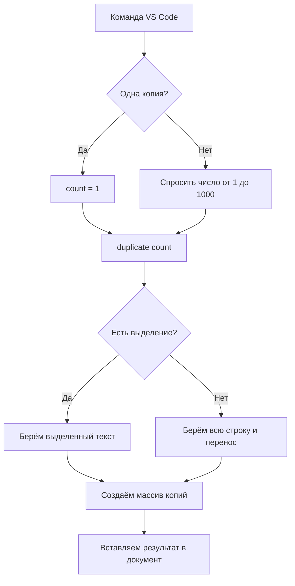

# Duplicate Line Better

**IDE:** Visual Studio Code  
**Автор и группа:** Махенько Александр Евгеньевич М3103

## Описание

Расширение дублирует текущую строку или выделенную часть текста.

- **Ctrl+Alt+D** — создать одну дополнительную копию.
- **Ctrl+Alt+Shift+D** — запросить количество дополнительных копий (1–1000).
- Если текст **не выделен**, копируется вся строка под курсором.
- Если текст **выделен**, копируется только выделение, сразу после него.
- Сохраняются пробелы и формат переноса строк (`LF` / `CRLF`).
- Несколько копий вставляются за одно изменение редактора (можно отменить одним `Ctrl+Z`).

## Короткое техническое задание

Создать расширение VS Code на TypeScript, которое регистрирует две команды: копирование строки/выделения один раз и заданное число раз. При вводе количества проверять, что это целое число от 1 до 1000. Не изменять другие строки документа.

## Как устроен код

Весь код плагина находится в `src/extension.ts`. Есть две функции:

- `activate(context)` — регистрирует команды через API VS Code.
- `duplicate(count)` — узнаёт, что выделено, собирает копии в массив строк `string[]`, объединяет их с помощью `join('')` и вставляет через `editor.edit`.

## Запуск и проверка

1. Открыть папку проекта в VS Code.
2. Выполнить `npm install` и `npm run compile`.
3. Нажать `F5`, чтобы открыть тестовое окно VS Code (Extension Development Host).
4. Открыть любой текстовый файл, проверить обе комбинации клавиш.

## Технологии

TypeScript и [VS Code Extension API](https://code.visualstudio.com/api).

